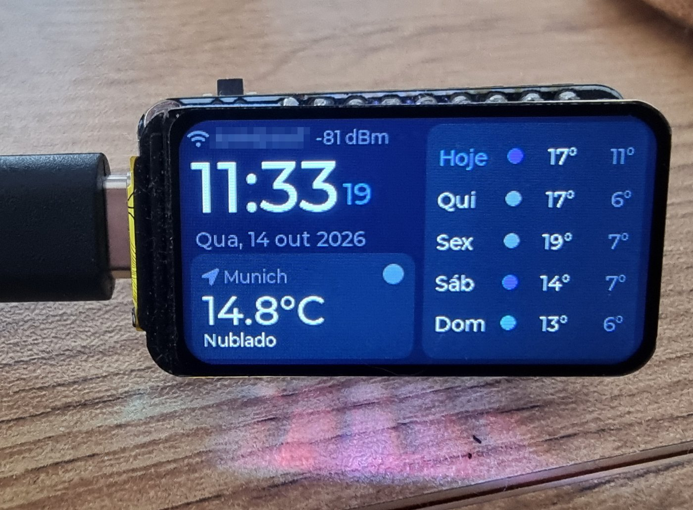
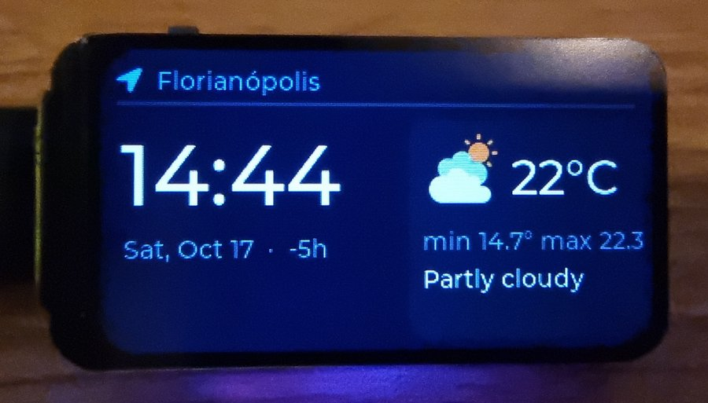
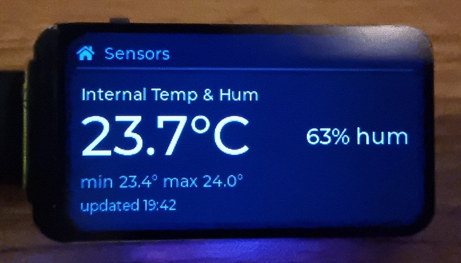
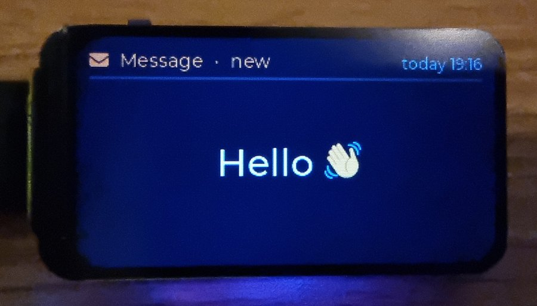
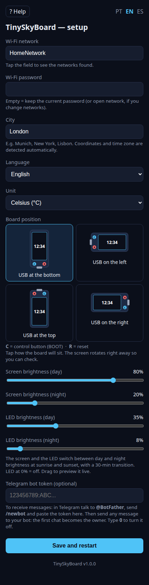
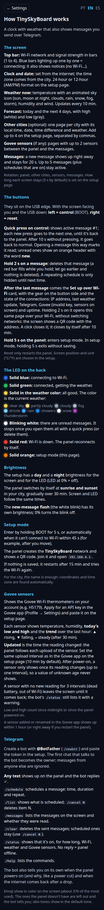

# TinySkyBoard

A desk clock, weather station and message board for the
[Waveshare ESP32-C6-LCD-1.47](https://www.waveshare.com/esp32-c6-lcd-1.47.htm).
It shows the time, current weather and a 5-day forecast, weather details (UV, air quality, rain
by the hour), other cities' time and weather, readings from your Govee Wi-Fi thermometers, and
messages and reminders you and your family send over Telegram. At night it turns into a discreet
clock that still wakes up for a medicine reminder.

Everything is configured from your phone or computer through a setup page served by the board
itself: no reflashing when you move or change networks.

> ### ⚡ Install it in 3 minutes — no programming, nothing to install
>
> You don't need to compile anything. Open the **TinySkyBoard flasher** in Chrome or Edge on a computer:
>
> ## 👉 [hbn211.github.io/TinySkyBoard](https://hbn211.github.io/TinySkyBoard/)
>
> It's a web page (hosted for free by GitHub) that talks to the board over the USB cable — modern
> browsers can do that — and writes the latest TinySkyBoard into it. The page shows each step with
> pictures: plug in the cable, hold **BOOT** and tap **RESET**, click **Flash the board**, then
> press **RESET**. The same page updates a board later and keeps its settings.

**Version 1.9.0** — see the [changelog](CHANGELOG.md). The version also shows at the bottom of
the setup page and in the bot's `/status` reply.



*The dashboard in landscape: clock, weather now with an animated icon, and the 5-day forecast.*

| Other city | Govee sensor | New message |
|---|---|---|
|  |  |  |

| Setup page | Built-in help |
|---|---|
|  |  |

## Features

- **Clock and date** synced over NTP; the time zone (including daylight saving) is detected
  from the city. 24-hour or 12-hour (AM/PM) format.
- **Weather details page**: tiles with the feels-like temperature, UV index, air quality (European
  AQI) and the chance of rain for each of the next 6 hours, with the usual color scales.
- **Work forecast** (optional): at the times and on the weekdays you choose (e.g. 06:15–08:00,
  Monday to Friday), a page with the weather in the city where you work and its next 12 hours.
- **Other cities** (optional, up to 4): a world-clock page per city with its local time, date,
  time difference and weather.
- **Weather now + 5-day forecast** from [Open-Meteo](https://open-meteo.com/) — no API key. An
  animated icon shows the sky (sun or moon, drifting clouds, falling rain or snow, fog, lightning).
  Just type the city name; coordinates are looked up automatically.
- **Govee thermometers** (optional, e.g. H5179): temperature, humidity, today's low/high and the
  trend over the last hour, with the time of the last upload. One sensor fills the screen; two
  share it. A sensor that stops reporting leaves the screen by itself. Optional **comparison
  pages** (e.g. living room × outside) and **Telegram alerts** when a reading leaves the range you
  set or a sensor goes silent.
- **Telegram messages** on the screen, with **color emoji** (about 370 of the most used, from
  Twemoji). Up to 5 messages take turns with the dashboard.
  The bot warns you when a message is too long to fit. **Up to 4 more people** (family) can be
  invited with a link; the screen then shows who sent each message.
- **Scheduled messages** (`/schedule`): a step-by-step assistant with quick-reply buttons —
  time, duration and repeat (once, every day, Mon–Fri, weekends). Optionally the reminder also
  arrives in Telegram when it starts, with a **✅ Done** button that clears it from the screen
  (handy for "take the medicine"); deleting it on the panel updates that button too. With other
  people on the bot, it goes either to whoever scheduled it or to everyone: whoever taps ✅ Done
  clears it, and the others' buttons say who did.
  They can also be created, edited and deleted on a **Scheduled messages** page, linked from the
  setup page when it's opened over your home network, and browsed or deleted on the panel itself.
- **Rain alert** (`/rain`): a Telegram message when rain becomes likely in the next hours.
- **Uptime notices**: the bot tells you when the panel powers on (and why — e.g. a power cut,
  with how long it was off, or a crash with where it happened) and when the internet comes back
  after an outage. `/status` answers whether it's alive, and lists the Govee sensors.
- **Night mode** (optional): during the hours you choose, only a large clock in a warm color and
  the LED off; a new message or a click lights the panel up for a few seconds, and a reminder
  takes turns with the clock while the LED breathes red.
- **Day/night dimmer**: screen and LED brightness follow local sunrise and sunset, with a
  30-minute transition.
- **RGB LED** in the color of the current weather, blinking white until new messages are read.
- **Adjustable rotation**: how long the clock, other cities, sensor pages and messages stay on
  screen (5 s by default), with slide transitions and a thin bar showing the time left on each page.
- **Status at a glance**: Wi-Fi signal bars on the dashboard, and a status list (IP, weather,
  Telegram, Govee, uptime) on the **Set up over Wi-Fi** card.
- **Setup portal**: the board creates its own Wi-Fi with a QR code on screen, or opens the same
  page on your home network from the panel. Pick the network, city, other cities, language, unit,
  time format, night mode, board orientation, brightness (with live preview), screen times, work
  forecast, Telegram, Govee, sensor alerts and comparisons — from your phone, or in two columns on a
  computer. A **backup file** carries the settings and schedules to another board.
- **Three languages** — English, Portuguese and Spanish — on the screen, the setup page and
  the bot.

## Hardware

**Waveshare ESP32-C6-LCD-1.47**: ESP32-C6 (Wi-Fi 6, BLE 5), 4 MB flash, 1.47" ST7789 LCD
(172×320), WS2812 RGB LED, BOOT and RESET buttons. Nothing else is needed — a USB-C cable
powers it.

| Function | GPIO |
|---|---|
| LCD MOSI / SCLK / CS / DC / RST | 6 / 7 / 14 / 15 / 21 |
| LCD backlight (PWM) | 22 |
| RGB LED (WS2812) | 8 |
| BOOT button | 9 |

With the screen facing you and the USB port down, the two buttons sit on the USB edge:
**left = control (BOOT)**, **right = reset**.

## Installing

**From the browser (easiest, no tools):** open **[hbn211.github.io/TinySkyBoard](https://hbn211.github.io/TinySkyBoard/)**
in Chrome or Edge on a computer and follow its steps: connect the board with a USB-C data cable,
put it in flashing mode (hold **BOOT**, press and release **RESET**, release **BOOT**), click
**Flash the board**, pick the port and **Install**, then **press RESET** when it's done. To update,
leave "Erase device" off: the settings stay.

**From a release:** each [release](https://github.com/hbn211/TinySkyBoard/releases) has
`tinyskyboard-<version>-esp32c6-full.bin`, to write at offset `0x0` with
[esptool](https://docs.espressif.com/projects/esptool/) (this erases the saved settings):

```bash
esptool --chip esp32c6 write-flash 0x0 tinyskyboard-1.4.0-esp32c6-full.bin
```

Releases are built by GitHub Actions (`.github/workflows/release.yml`) when a version tag is
pushed; the same run publishes the browser flasher (`flasher/`) on GitHub Pages.

## Building from source

Requires [ESP-IDF](https://docs.espressif.com/projects/esp-idf/) **v6.0** (other 5.4+
versions will probably work). Dependencies (LVGL, esp_lvgl_port, led_strip, cJSON) are
downloaded by the IDF Component Manager on the first build.

```bash
git clone https://github.com/hbn211/TinySkyBoard.git
cd TinySkyBoard
idf.py set-target esp32c6
idf.py build
idf.py -p /dev/ttyACM0 flash monitor     # the port name may differ
```

You don't need to set anything in `menuconfig`. With an empty Wi-Fi network (the default), the
board boots straight into setup mode.

## First setup

1. Power the board. The screen shows **SETUP MODE** and a QR code; the LED is orange.
2. Scan the QR code (or join the open **TinySkyBoard** Wi-Fi). The setup page opens by itself —
   if not, open `http://192.168.4.1`.
3. Pick your network, type the password and the city, then tap **Save and restart**.

To change settings later, either click through to the **Set up over Wi-Fi** card and hold it for 2 seconds
(the page opens on your home network, no network switching), or **hold the control button for 5 seconds**
to restart into setup mode with its own Wi-Fi. The panel also opens the
setup page by itself if it can't connect to Wi-Fi within 45 seconds (for example, after you
move). Without any change, setup mode restarts after 15 minutes and tries the Wi-Fi again.

At the bottom of the setup page, **Download the configuration** saves a file with the settings,
sensor alerts and scheduled messages; **Load a configuration file** fills a new board with it
(then type the Wi-Fi password and the tokens, which the file leaves out, and tap **Save**).

## Using it

### Control button

| Action | What it does |
|---|---|
| Quick press | Shows active message #1; each press goes to the next, then back to the dashboard. 10 s without pressing returns to normal. Opening a message this way marks it read (unread ones have an orange header). |
| Hold 2 s on a message | Deletes it (a red bar fills while you hold; let go earlier to cancel). |
| Quick press past the last message | Shows the **Set up over Wi-Fi** card: a gear on the button side and a status list — IP address, last weather update, Telegram, Govee (invalid key, sensors on screen) and uptime. |
| Hold 2 s on the **Set up over Wi-Fi** card (after the last message) | Opens the setup page on your home network and shows a QR code with the board's address. A click closes it; it closes by itself after 10 minutes. |
| Quick press on the **Set up over Wi-Fi** card | Goes to the **Night mode** card (moon, and whether night mode is on now). Another press goes back to the dashboard. |
| Hold 2 s on the **Night mode** card | Turns night mode **on now** (a nap in the afternoon; it ends when you turn it off, or after 12 h) or **off** — off for the rest of tonight's hours if it's the scheduled night. The scheduled hours don't change. |
| Quick press on the **Night mode** card | Goes to the **Schedule** card (how many scheduled messages there are). Another press goes back to the dashboard. |
| Hold 2 s on the **Schedule** card | Opens the schedules on the panel: text, time · duration · repeat and state. A quick press goes to the next one; 10 s without pressing goes back to normal. |
| Hold on a schedule | A bar runs through four zones — *nothing* (gray), *delete today* (orange), *delete all* (red), *nothing* (gray) — and says what releasing now would do. **Releasing** does it: *delete today* skips today's occurrence (or the next one if today's is over) and keeps the series; *delete all* deletes the schedule, like `/cancel N`. |
| Hold 5 s on the dashboard | Enters setup mode (and leaves it, without saving). |

### Screen rotation

The screens take turns: **clock and weather → weather details → work forecast (in its hours) →
other cities → Govee sensor pages → sensor comparisons → messages → clock**. Pages slide in from the right, and a thin bar at the
bottom shrinks until the next one (at night they just swap). Pages that have nothing to show are skipped. Each screen stays 5 s by default; change it
on the setup page (2–30 s). A new message stays 20 s the first time.

### Dashboard

- **Top bar:** Wi-Fi network with 1–4 signal bars (≥ −55, −65, −75 dBm, weaker). While
  connecting, blue bars light up one by one next to the network name.
- **Clock** (24 h, or 12 h with AM/PM next to the seconds) and date.
- **Weather now:** city, temperature and an animated icon — sun with a glow (moon at night),
  drifting clouds, falling rain or snow, fog bars, lightning — plus humidity and wind in portrait.
- **Forecast:** today and the next 4 days with a weather icon, high (white) and low (gray).

### Rain alert

Send `/rain` (`/chuva`, `/lluvia`) to the bot to turn it on or off. When it's on, the bot tells you
when the chance of rain reaches 60 % this hour or in the next two (not if it's already raining),
at most once every 6 hours: *"🌧 70 % chance of rain at 15:00 in Munich."*

### Night mode

Off by default. Turn it on on the setup page and pick the times (00:00–06:00 by default), or
switch it on and off right away from the **Night mode** card (after the setup card). During
them the screen shows only a large clock (it fills the screen; in portrait, hours above minutes)
and the date in a dim amber, and the LED stays off — the unread blink too. A new message shows
alone for 20 seconds (no weather pages), then the clock comes back; a click wakes the whole panel
for 20 seconds (the first click only wakes it). A **scheduled** message that starts at night — say, a medicine reminder — takes turns with
the night clock (clock 5 s, reminder 8 s; nothing else unless you click) and the LED **breathes
red** until you open it, delete it or its time is over.

### Weather details

A page right after the dashboard (on by default; turn it off on the setup page):

- **Feels like** — apparent temperature.
- **UV** — the index with its WHO level (low, moderate, high, very high, extreme) in its color. At
  night the current UV is always 0, so it shows today's maximum instead and says so.
- **Air** — European Air Quality Index (good, fair, moderate, poor, very poor, extremely poor).
- **Rain, next 6 h** — a bar per hour with the chance of rain; the most likely hour is highlighted.

Everything comes from Open-Meteo (forecast and air-quality APIs, no key).

### Work forecast

Type the city where you work under **Work forecast** on the setup page, pick the times (06:00–08:00
by default, to the minute) and the weekdays (Monday to Friday by default; untick your home-office days). During
those hours a page joins the rotation right after the weather details: the weather there now
(animated icon, temperature, low/high, sky) and the next 12 hours every 2 hours — a bar for the
chance of rain, the temperature above it. It doesn't show under the night clock. The panel only
fetches it from an hour before until the end of the window.

### Other cities

Type them on the setup page under **Other cities**, separated by commas (up to 4), e.g.
`Florianópolis, Tokyo`. Empty (the default) turns the feature off. Each city gets a page with its
local time, date and difference to yours (e.g. `-4h`), and its weather (animated icon with day or
night there, temperature, today's low and high). Coordinates and time zone come from Open-Meteo,
daylight saving included, and are refreshed with the weather.

### Govee sensors

1. In the Govee app, go to **Profile → Settings → Apply for API Key**; the key arrives by email.
2. Paste it on the setup page (**Govee API key**). Type `0` there to turn the sensors off.
3. Set **Govee sensor upload interval** to the same value as in the Govee app (10 min by default).

Every thermometer on the account shows up by itself (up to 8). The list is re-read every hour, so a
sensor added or renamed in the Govee app appears within an hour — or right away after a restart.
Each card shows the name from the Govee app, temperature (in the panel's unit), humidity, today's
low and high, and a trend arrow — rising ▲ or falling ▼ by 0.3° or more over the last hour, or
steady –, after 30 minutes of history.

The Govee API doesn't say when a reading was taken, and it keeps reporting a sensor as online with
its last value after the battery dies. So the panel works from **changes**:

- It polls every 5 s until the value changes (that's the upload), then sleeps until 30 s before
  the next expected upload. That's roughly 1,000 requests per sensor per day.
- **"updated HH:MM"** is when the reading last changed. After power-on a sensor shows up with its
  first reading right away; the time appears with the first change.
- A sensor whose reading doesn't change at all for **12 hours** leaves the screen until it changes
  again (`/status` still lists it, with a warning). An indoor sensor can repeat the same value for a
  while, which looks like silence; 12 hours always cross the day's low or high.

**Alerts on Telegram.** Under **Sensor alerts** on the setup page, each sensor has a min/max
temperature (in the panel's unit) and min/max humidity; leave blank what you don't want to watch.
The limits are saved by the sensor's Govee ID, so they survive renames. The bot sends one message
when a reading leaves the range and one when it's back — "back" only counts once it's 0.5° (2 % for
humidity) inside the range, so a value hovering at the limit doesn't flood you. Only new readings
are checked. A checkbox adds a message when a sensor stops sending (the same moment it leaves the
screen) and when it comes back. Alerts need the Telegram bot.

**Dew point.** Each sensor card also shows the dew point, computed from temperature and
humidity (Magnus formula, `main/psychro.h`). Relative humidity misleads when temperatures differ:
outside at 3 °C / 90 % "looks" damp but holds far less water than a room at 21 °C / 55 % — dew
point 1.5 °C against 11.6 °C; heated to 21 °C, that outside air would be at ~27 %.

**Comparisons.** Under **Compare sensors** on the setup page, pick two sensors (A × B), up to two
pairs — say living room × outside. Each pair gets a page after the sensor pages with the
difference A − B in the middle (orange when A is warmer, blue when cooler), and below it the
humidity and dew point differences (cyan when A holds more water, sand when less); each side shows
its reading and dew point. It shows only while both sensors have fresh readings.

Two options per pair:
- **Sensor B is outdoors** adds **Air out: yes / no / either** at the bottom. **Yes** (a pulsing
  green band) needs both: the humidity inside at the limit or above (**60 %** by default, set under
  *Compare sensors*; mould risk starts around there) and the dew point inside 3 °C above outside.
  It holds until the humidity drops 5 % under the limit or the difference under 2.5 °C. **No** when
  the air outside holds as much water (difference ≤ 1 °C, until over 1.5 °C). Otherwise *either*:
  drier air outside alone isn't a reason to cool the house. The margins cover the sensors' ±3 %
  humidity, so the hint doesn't flicker.
  Air out wide open for 5–10 minutes and close: a quick change of air doesn't cool the walls and
  furniture, while a tilted window for hours wastes heating.
- **Telegram alert when airing out helps** (with the first option on): "good time to air out" when
  the hint turns to yes, at most once every 3 hours per pair, and "you can close the windows" when it
  turns to no after one of those, sent to the owner and the invited people. Nothing at power-on or
  during the night-mode hours.

`tools/govee_probe.py` lists your sensors and watches their readings from a computer (it reads
the key from the `GOVEE_API_KEY` environment variable).

### LED

| LED | Meaning |
|---|---|
| Solid blue | Connecting to Wi-Fi |
| Solid green | Connected, fetching the weather |
| Weather color | All good: yellow clear sky, gray cloudy, blue rain, purple storm… |
| Breathing red | A scheduled message (reminder) unread during night-mode hours — color and mode (blink, breathe, solid) on the setup page |
| Blinking white | Unread messages — stops once you open them all with a quick press (or delete them). Color and mode (blink, breathe, solid) are set on the setup page, with a live preview; its brightness is a separate setting (0% = no blink). |
| Solid red | Wi-Fi is down (reconnects by itself) |
| Solid orange | Setup mode |

### Telegram bot

1. In Telegram, talk to **@BotFather**, send `/newbot` and copy the token.
2. Paste the token on the setup page.
3. Send any message to your bot. **The first chat to talk to it becomes the owner**; everyone
   else gets "this panel is private".
4. Optional: `/invite` gives you a link (and a code) valid for 10 minutes; forward it to someone at
   home, they tap it and **Start**, and they can send messages and schedules too (up to 4 people).
   `/members` lists them with a button to remove each one. With more than one person, the panel
   shows who sent each message. Alerts, the power-on notice, `/rain`, `/invite` and `/members`
   stay with the owner (the airing-out alert goes to everyone, whoever is home can open the
   windows); a ✅ Done reminder goes to whoever scheduled it.

Commands work in any of the three languages; the bot's `/` menu shows them in the panel's
language.

| English | Português | Español | |
|---|---|---|---|
| *(any text)* | | | Shows it on the panel |
| `/schedule` | `/agendar` | `/programar` | Schedule a message |
| `/list` | `/agenda` | `/lista` | List what is scheduled |
| `/cancel N` | `/cancelar N` | `/cancelar N` | Delete schedule N |
| `/messages` | `/mensagens` | `/mensajes` | Messages on the screen and whether they were read |
| `/rain` | `/chuva` | `/lluvia` | Rain alert on/off (also `/rain on`, `/rain off`) — owner |
| `/invite` | `/convidar` | `/invitar` | Link/code for someone else to use the panel — owner |
| `/members` | `/membros` | `/miembros` | Who else uses the panel, with remove buttons — owner |
| `/clear` | `/limpar` | `/borrar` | Delete the sent messages (scheduled ones stay) |
| `/status`, `/ping` | `/status` | `/estado` | Is it on? Uptime, Wi-Fi, weather, Govee sensors |
| `/help` | `/ajuda` | `/ayuda` | List the commands |

The scheduling assistant understands times like `18:30`, `18h`, `tomorrow 08:00`, `12/25 09:00`
(day/month in Portuguese and Spanish) and `in 30 min`, and durations like `30 min`, `2 h`,
`1h30` or `1 day`.

### On the computer (Windows, Ubuntu/GNOME) — experimental

The computer shows the panel by the clock: on Windows the temperature is the notification-area icon,
on GNOME it's in the top bar; a click shows the sensors, the airing-out hint, the latest messages
(unread ones marked) and the next schedule. It is a **mirror**: it only listens to the panel on the
same Wi-Fi network and never sends anything to it. It follows the computer's language (English,
Portuguese or Spanish). Tested on Windows and on Ubuntu 26.04 (GNOME Shell 50).

First, on the panel's setup page, under *Computer and other panels*, tick **Share on the home
network** (it is off by default): the **pairing code** (`XXXX-XXXX`), made by the panel, shows right
below. Copy it and **Save**.

**Windows**

1. Download `TinySkyBoard-…-windows.exe` from the [latest release](https://github.com/hbn211/TinySkyBoard/releases/latest)
   and put it in a folder of its own, like `C:\TinySkyBoard` (*Start with Windows* starts it from
   there). It isn't signed: if Windows says it protected the PC, click *More info* → *Run anyway*.
2. Run it and type the pairing code. If the firewall asks, allow it on **private networks**; the
   Wi-Fi network must be set as *Private* in Windows' network settings.
3. The temperature shows by the clock (on Windows 11 maybe under the **^** arrow: drag it to the
   taskbar). Its menu has *Change the pairing code…*, *Start with Windows*, *Open the log* and *Quit*;
   when nothing arrives, a grey line in the menu says why.

To remove it: untick *Start with Windows*, *Quit*, and delete the `.exe` and the folder
`%APPDATA%\TinySkyBoard` (the code and the log).

**Ubuntu / GNOME**

1. Download `tinyskyboard-…-gnome-extension.zip` from the
   [latest release](https://github.com/hbn211/TinySkyBoard/releases/latest) and unzip it (or use
   `tools/gnome-extension` in a copy of this repository). In a terminal, in that folder:
   ```sh
   ./install.sh XXXX-XXXX
   ```
   (without the code it asks for it). It copies the extension to your user's GNOME extensions,
   saves the code in `~/.config/tinyskyboard/code` and turns the extension on.
2. If it doesn't show up in the top bar, log out and back in (GNOME only finds new extensions at
   login).

If the computer has a firewall, allow incoming UDP on port 47474 from the home network
(`sudo ufw allow 47474/udp`).

**What it shows (GNOME)**

| | |
|---|---|
| Top bar | Weather icon and temperature; a dot when there are unread messages |
| `--°` and a crossed-out network icon | Nothing heard from the panel for 90 s (off, another network or another code) |
| Footer | How many panels it hears |

It updates within 5 s of any change on the panel, and at least every 30 s.

**New code**: tick *Make a new code* on the setup page: the new one shows at once; copy it and save.
Computers (and other panels) with the old one stop receiving: on Windows use *Change the pairing
code…* in the menu, on GNOME run `install.sh` again with the new code.

**Uninstall (GNOME)**

```sh
./install.sh --uninstall           # removes the extension, keeps the code
./install.sh --uninstall --purge   # also removes the pairing code
```

Without the downloaded folder: `gnome-extensions uninstall tinyskyboard@hbn211.github.io`, and
`rm -r ~/.config/tinyskyboard` for the code.

Panels with the **same pairing code** on the same network also share what arrives through Telegram:
a message sent to one shows on all of them, and a new schedule is added to all of them.

## Privacy and security

- **Wi-Fi password, Telegram token and Govee API key** entered on the setup page are stored
  **only on the board** (NVS flash). They never touch your computer or this repository.
- Anything you type in `menuconfig` ends up in `sdkconfig` (ignored by git) **and inside the
  compiled firmware**. Don't share a `.bin` built with your credentials in `menuconfig` —
  the setup page is the safer place for them.
- NVS is **not encrypted**: someone with physical access to the board could read the
  credentials.
- The setup Wi-Fi **TinySkyBoard** is open while setup mode runs (at most 15 minutes).
- When opened from the **Set up over Wi-Fi** card, the page (with the scheduled messages and the
  configuration backup) is reachable by anyone on your home network until you close it or after
  10 minutes without use. It never shows the saved Wi-Fi password, bot token or Govee key, and the
  backup file leaves them out (and the pairing code).
- With **Share on the home network** on (off by default), the panel sends its screen (weather,
  sensors, the latest messages and the next schedule) to the home network every 30 s for the
  computer extension and the other panels. The packets are
  **encrypted and signed** with keys made from the pairing code: without it, nobody on the network can
  read them or make a panel show something, and a packet recorded and sent again later (more than
  2 minutes off the panel's clock) is dropped. Only the packet type and the sender's address show.
- The bot only obeys its owner and the people the owner invited. To hand it over, enter `0` as the
  token on the setup page and then the token again: the next chat to talk to it becomes the owner.

## Project layout

```
main/
  main.c          boot, control button
  crash.c         remembers where a crash happened, for the power-on notice
  board.c/.h      LCD (ST7789 + LVGL), backlight, RGB LED, pins
  ui.c            dashboard, message screen, setup-mode screen
  net.c           Wi-Fi, NTP, Open-Meteo weather (main and other cities), geocoding, HTTPS helper
  telegram.c      bot: messages, commands, /schedule assistant, uptime notices
  lan.c           home network: encrypted, signed UDP broadcasts between panels and to the computer mirror
  govee.c         Govee thermometers: polling in sync with the uploads, trend, day range
  psychro.h       dew point and the airing-out hint (header only)
  schedule.c/.h   active messages and schedules
  weather_icon.c  animated weather icon (Twemoji sun/moon/cloud + LVGL drops, flakes, lightning)
  dimmer.c        day/night brightness from sunrise/sunset
  led.c           RGB LED
  portal.c        setup page (own Wi-Fi or home network), scheduled messages page, backup
  portal_help.c   help page
  config.c/.h     settings in NVS
  i18n.c/.h       all user-facing texts (en, pt, es)
  emoji/          color emoji: generated images (emoji.bin) and their index
  fonts/          Montserrat with Latin-1 accents + LVGL symbols
tools/
  govee_probe.py  checks the Govee API from a computer (standard library only)
  gen_emoji.py    builds main/emoji from emoji_list.txt
  lan_peer.py     acts as a panel from a computer: listen, send messages and schedules, stress test
  gnome-extension/  the GNOME top-bar mirror (and test_lan.js, its receiver without GNOME Shell)
  windows/        the Windows notification-area mirror (Go; builds on Linux too, see its README)
flasher/          browser flasher page (ESP Web Tools), published by the release workflow
.github/workflows release build: firmware files on the release, flasher on GitHub Pages
partitions.csv    single 3.9 MB app partition
sdkconfig.defaults
```

The fonts in `main/fonts/` were generated with
[lv_font_conv](https://github.com/lvgl/lv_font_conv) from Montserrat Medium and Font Awesome
(the exact command is in the header of each file).

The color emoji in `main/emoji/` are [Twemoji](https://github.com/jdecked/twemoji) images
converted to LVGL's RGB565A8 format in three sizes (16, 22 and 28 px) and drawn through an LVGL
image font that is the fallback of the message fonts. The set is listed in `tools/emoji_list.txt`;
to change it, edit the list and run `python3 tools/gen_emoji.py` (needs Pillow). Emoji outside the
set are dropped and the bot says so; skin tones show in the default tone, and in combined emoji
(people with professions, families, flags) only the first part shows.

## Known limitations

- Only the emoji in `tools/emoji_list.txt` show; flags and combined emoji don't.
- One owner per bot, plus up to 4 invited people.
- Govee low/high and trend start over when the panel restarts (the API has no history).
- A dead Govee sensor is only noticed after 12 hours without any change (the API doesn't say when
  a reading was taken).
- The board-position picker assumes rotation 0 is "USB at the bottom". If "left" and "right"
  come out swapped on your board, swap the 1 and the 3 in `BOARD_USB_TO_ROT` (`main/board.h`).

## Credits and licenses

This project is released under the [MIT License](LICENSE). It builds on:

| Component | License |
|---|---|
| [ESP-IDF](https://github.com/espressif/esp-idf) | Apache-2.0 |
| [LVGL](https://github.com/lvgl/lvgl) | MIT |
| [esp_lvgl_port](https://components.espressif.com/components/espressif/esp_lvgl_port), [led_strip](https://components.espressif.com/components/espressif/led_strip) | Apache-2.0 |
| [cJSON](https://github.com/DaveGamble/cJSON) | MIT |
| [Montserrat](https://github.com/JulietaUla/Montserrat) font | SIL Open Font License 1.1 |
| [Font Awesome Free](https://fontawesome.com/) icons (via LVGL) | SIL OFL 1.1 (font), CC BY 4.0 (icons) |
| [Twemoji](https://github.com/jdecked/twemoji) emoji graphics, © Twitter, Inc. and other contributors | CC BY 4.0 |

Weather data by [Open-Meteo.com](https://open-meteo.com/), licensed under
[CC BY 4.0](https://creativecommons.org/licenses/by/4.0/). The free Open-Meteo API is for
non-commercial use.
